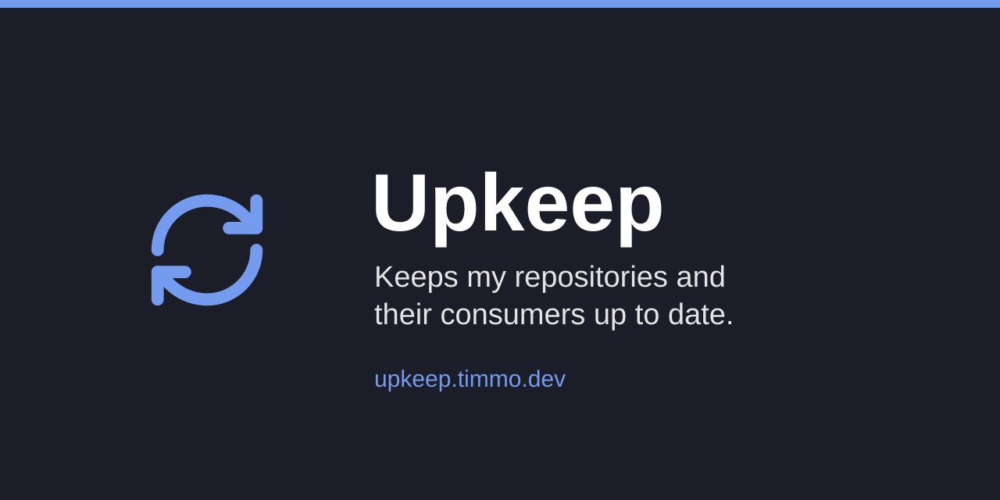

# Upkeep

Keeps my repositories and their consumers up to date, and shows what needs
doing. A worker runs the jobs: rolling each first-party release out to its
consumers, updating dependencies and applying labels, with changes checked
before they're pushed and failures fixed forward. A web dashboard, built on
[groundwork](https://github.com/timmo001/groundwork), shows their state beside
pull requests, issues, notifications and releases.

The server runs as a Home Assistant app, in
[my apps repository](https://github.com/timmo001/home-assistant-apps):

The plan and its progress
live in [#1](https://github.com/timmo001/upkeep/issues/1), with the working
document attached to it. The docs are at <https://upkeep.timmo.dev>.
